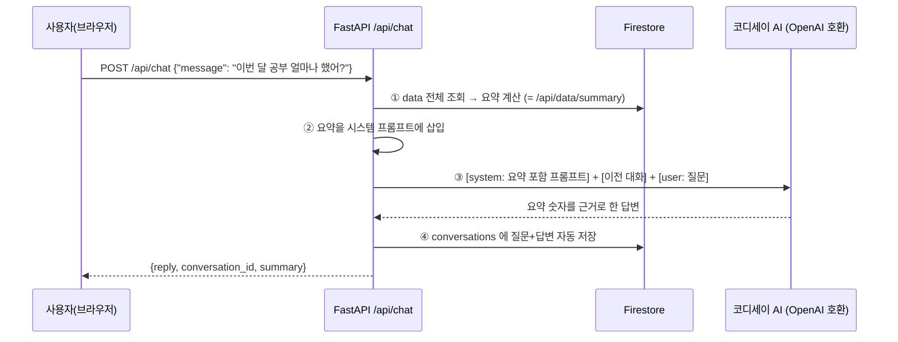
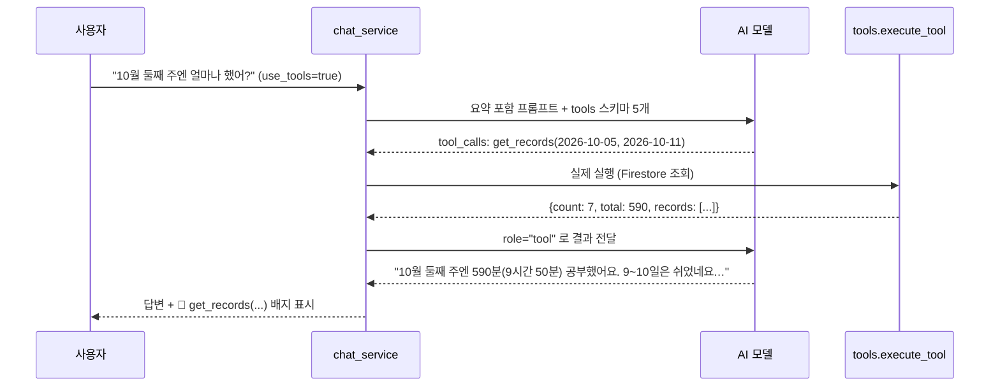

# 📚 스터디 메이트 — 내 공부 기록을 아는 AI 코치

> **AI Agent 개발: 나만의 AI 비서 구축** 과제 결과물
> 하루 공부 시간(분)을 기록하면, AI가 **내 기록 요약을 보고** 맞춤형으로 답해주는 웹 서비스

일반 ChatGPT에게 "이번 달 공부 얼마나 했어?"라고 물으면 "기록을 알려주세요"라는 답만 돌아옵니다.
스터디 메이트는 내 공부 기록을 Firestore에 저장하고 분석한 **요약을 시스템 프롬프트에 자동으로 넣어서**,
"이번 달은 22일 동안 47시간, 하루 평균 128분으로 지난달보다 19% 늘었어요" 같은 **내 상황을 아는 답변**을 해줍니다.

- **데이터 주제**: 하루 공부 시간 기록 `(date, value=공부한 분, memo=공부한 내용)` — 숫자 1개라 입문자도 이해하기 쉽습니다.
- **AI**: 경남 코디세이에서 받은 API 키 (OpenAI 호환 방식, `.env` 3줄만 바꾸면 됨)

---

## 목차
1. [주요 기능](#1-주요-기능)
2. [기술 스택](#2-기술-스택)
3. [배포 URL](#3-배포-url)
4. [폴더 구조](#4-폴더-구조)
5. [로컬 실행 방법](#5-로컬-실행-방법)
6. [환경 변수 목록](#6-환경-변수-목록)
7. [경남 코디세이 API 키 사용법](#7-경남-코디세이-api-키-사용법)
8. [API 명세](#8-api-명세)
9. [데이터 설계와 분석](#9-데이터-설계와-분석)
10. [컨텍스트 주입 (AI 채팅의 원리)](#10-컨텍스트-주입-ai-채팅의-원리)
11. [보너스 ① 도구 호출 + MCP 서버](#11-보너스--도구-호출function-calling--mcp-서버)
12. [보너스 ② 인사이트·UX 고도화](#12-보너스--인사이트ux-고도화)
13. [배포 요약 (Render / Vercel)](#13-배포-요약-render--vercel)
14. [보안 · 비용 관리](#14-보안--비용-관리)
15. [제출 스크린샷](#15-제출-스크린샷)
16. [요구사항 체크리스트](#16-요구사항-체크리스트)

---

## 1. 주요 기능

| 기능 | 입력 / 요청 | 출력 / 화면 |
|---|---|---|
| **데이터 기반 AI 채팅** | 자연어 질문 | 저장된 데이터 요약을 반영한 답변 + "AI가 분석 중…" 로딩 표시 |
| **데이터 관리 (CRUD)** | `(date, value, memo)` 추가 / 수정 / 삭제 | 목록 즉시 갱신 + 저장 결과 토스트 알림 |
| **대화 기록** | 자동 저장 · 목록 조회 · 불러오기 · 삭제 | 왼쪽 대화 목록, 클릭하면 메시지 전체 재표시 → 이어서 대화 가능 |
| **배포 · 문서화** | 배포 URL 접속 | Vercel 프론트 + Render 백엔드 + Swagger UI(`/docs`) + 이 README |
| ⭐ 보너스: 도구 호출 | "🔧 도구 호출 모드" 켜고 질문 | AI가 필요한 기능(기간별 기록, 통계, 이전 대화)을 직접 호출, 호출 내역 배지 표시 |
| ⭐ 보너스: MCP 서버 | Claude Desktop 등에서 질문 | 같은 기능을 외부 AI 클라이언트에서 도구로 사용 |
| ⭐ 보너스: 통계·그래프 | 기간(30/60/90일/전체), 목표 시간 | 목표 달성률·연속 공부일·요일별 평균 + 막대/추세선 그래프 |
| ⭐ 보너스: 내보내기 · 다크 모드 | CSV / JSON 버튼, 🌙 버튼 | 파일 다운로드, 테마 전환(새로고침해도 유지) |

## 2. 기술 스택

| 구분 | 사용 기술 |
|---|---|
| Backend | Python 3.10+, **FastAPI**, Uvicorn, Pydantic v2 |
| Database | **Firebase Firestore** (`firebase-admin`) |
| AI | **OpenAI 호환 Chat Completions API** (`openai` SDK, 경남 코디세이 키) |
| Frontend | **HTML / CSS / JavaScript** (프레임워크·차트 라이브러리 없음, 그래프는 SVG 직접 그림) |
| 배포 | 백엔드 **Render**, 프론트엔드 **Vercel** |
| 보너스 | Function Calling, MCP 서버(`mcp` Python SDK) |
| 기타 | python-dotenv (환경 변수) |

## 3. 배포 URL

> 배포 후 아래 주소를 본인 주소로 바꿔주세요.

| 구분 | URL |
|---|---|
| 프론트엔드 (Vercel) | https://study-mate-본인아이디.vercel.app |
| 백엔드 API (Render) | https://study-mate-api-본인아이디.onrender.com |
| Swagger UI | https://study-mate-api-본인아이디.onrender.com/docs |

⏰ **Render 무료 플랜 안내**: 15분 동안 요청이 없으면 서버가 잠들어서, 처음 접속할 때 최대 1분 정도 걸립니다.
화면 상단에 "서버를 깨우는 중이에요" 안내가 뜨고, 깨어나면 자동으로 사라집니다.

## 4. 폴더 구조

```
study-mate/
├── backend/                     # FastAPI (Render에 배포)
│   ├── main.py                  # 앱 생성, CORS, 에러 처리, 라우터 등록
│   ├── schemas.py               # Pydantic 요청/응답 스키마 (입력 검증)
│   ├── core/
│   │   ├── config.py            # 환경 변수 읽기
│   │   ├── database.py          # Firestore 연결
│   │   ├── ai_client.py         # ★ 코디세이(OpenAI 호환) AI 호출 - 여기 한 곳만 담당
│   │   ├── rate_limit.py        # AI 호출 횟수 제한 (과금 보호)
│   │   └── token_budget.py      # 월 토큰 한도 (Firestore 에 누적)
│   ├── routers/                 # "주소"만 담당 (얇게)
│   │   ├── data.py              # /api/data ...
│   │   ├── conversations.py     # /api/conversations ...
│   │   └── chat.py              # /api/chat
│   ├── services/                # "실제 일"을 담당
│   │   ├── analysis.py          # 시계열 분석: 요약·추세·통계 (순수 함수)
│   │   ├── data_service.py      # data 컬렉션 CRUD
│   │   ├── conversation_service.py
│   │   ├── chat_service.py      # 컨텍스트 주입 + GPT 호출 + 자동 저장
│   │   ├── tools.py             # (보너스) Function Calling 도구 정의/실행
│   │   └── errors.py
│   ├── scripts/
│   │   ├── seed_data.py         # 샘플 120일 생성 · 분석 · 업로드
│   │   └── check_setup.py       # 키/DB 연결 점검 (문제 해결용)
│   ├── data/study_log_sample.csv
│   ├── requirements.txt
│   └── .env.example
├── frontend/                    # 바닐라 JS (Vercel에 배포)
│   ├── public/
│   │   ├── index.html
│   │   ├── style.css            # 라이트/다크 테마
│   │   ├── app.js               # 채팅·대화기록·CRUD·통계 로직
│   │   ├── chart.js             # (보너스) SVG 그래프
│   │   └── config.js            # API 주소 (배포 시 자동 생성)
│   ├── generate-config.js       # Vercel 환경 변수 → config.js
│   └── vercel.json
├── mcp_server/                  # (보너스) MCP 서버
│   ├── server.py
│   └── claude_desktop_config.example.json
├── docs/
│   ├── DEPLOY_GUIDE.md          # Firebase/Render/Vercel 단계별 가이드
│   ├── LEARNING_NOTES.md        # 과제 목표 6가지 설명 노트
│   └── screenshots/             # 제출 스크린샷
└── render.yaml                  # (선택) Render Blueprint
```

**라우터 / 서비스로 나눈 기준**: 라우터는 "어떤 주소로 무엇을 받아 무엇을 돌려주는지"만, 서비스는 "DB 읽기/쓰기·분석·AI 호출" 같은 실제 처리를 담당합니다. 그래서 `chat_service`가 요약을 얻을 때 HTTP로 `/api/data/summary`를 다시 부르지 않고 같은 함수 `data_service.get_summary()`를 바로 재사용합니다.

## 5. 로컬 실행 방법

> 준비물: Python 3.10 이상, Firebase 서비스 계정 키 파일, 코디세이 API 키
> (Firebase 키 만드는 법은 [docs/DEPLOY_GUIDE.md](docs/DEPLOY_GUIDE.md#1-firebase-준비) 1단계)

### ① 백엔드

```bash
cd backend

# 1) 가상환경 만들고 켜기
python -m venv venv
source venv/bin/activate          # Windows: venv\Scripts\activate

# 2) 패키지 설치
pip install -r requirements.txt

# 3) 환경 변수 파일 만들기 → .env 를 열어 키 값 채우기
cp .env.example .env              # Windows: copy .env.example .env
#   - firebase-key.json 을 backend 폴더에 넣기 (GitHub에 안 올라가게 .gitignore 처리됨)

# 4) 설정 점검 (키·DB·AI 연결을 한 번에 확인)
python -m scripts.check_setup

# 5) 샘플 데이터 120일치 넣기 (분석 결과도 함께 출력됨)
python -m scripts.seed_data

# 6) 서버 실행
uvicorn main:app --reload
```

- Swagger UI: http://localhost:8000/docs
- 상태 확인: http://localhost:8000/health

### ② 프론트엔드 (새 터미널)

```bash
cd frontend/public
python -m http.server 5500
```

브라우저에서 http://localhost:5500 접속 (VS Code **Live Server**로 열어도 5500 포트라 그대로 동작)

> `config.js` 의 기본 API 주소가 `http://localhost:8000` 이라 로컬에서는 따로 설정할 것이 없습니다.

## 6. 환경 변수 목록

### 백엔드 (`backend/.env` / Render Environment)

| 이름 | 필수 | 설명 | 예시 |
|---|---|---|---|
| `OPENAI_API_KEY` | ✅ | 경남 코디세이에서 받은 API 키 | `sk-...` |
| `OPENAI_BASE_URL` | ✅ | 코디세이 API 주소 (OpenAI 공식 키면 비움) | `https://copa.codyssey.kr/v1` |
| `OPENAI_MODEL` | ✅ | 사용할 모델 ID | `gpt-5-mini` |
| `FIREBASE_SERVICE_ACCOUNT_JSON` | ✅* | 서비스 계정 키 JSON 내용 전체 (Render 추천) | `{"type":"service_account",...}` |
| `FIREBASE_SERVICE_ACCOUNT_PATH` | ✅* | 또는 키 파일 경로 (로컬 추천) | `./firebase-key.json` |
| `ALLOWED_ORIGINS` | ✅ | CORS 허용 프론트 주소 (쉼표 구분, 끝에 `/` 없이) | `https://study-mate.vercel.app` |
| `OPENAI_MAX_TOKENS` | | 답변 최대 토큰 (기본 1500) | `1500` |
| `CODYSSEY_SESSION_ID` | | 코디세이 사용량을 묶어 볼 세션 이름 | `study-mate` |
| `CHAT_LIMIT_PER_MINUTE` | | IP당 1분 AI 호출 제한 (기본 10) | `10` |
| `CHAT_LIMIT_PER_DAY` | | 서버 전체 하루 AI 호출 제한 (기본 200) | `200` |
| `TOKEN_LIMIT` | | 이번 달 AI 토큰 사용 한도 (기본 100,000, 0=제한 없음) | `100000` |
| `DAILY_GOAL_MINUTES` | | 하루 목표 공부 시간 기본값 (기본 120) | `120` |
| `ALLOWED_ORIGIN_REGEX` | | Vercel 미리보기 주소 허용용 정규식 | `https://study-mate-.*\.vercel\.app` |

\* Firebase 는 둘 중 하나만 설정합니다.

### 프론트엔드 (Vercel Environment Variables)

| 이름 | 필수 | 설명 | 예시 |
|---|---|---|---|
| `API_BASE_URL` | ✅ | 백엔드(Render) 주소, 끝에 `/` 없이 | `https://study-mate-api.onrender.com` |

> 순수 HTML/JS는 환경 변수를 직접 읽지 못하므로, Vercel 빌드 때 `generate-config.js`가 `API_BASE_URL` 값으로 `config.js`를 만들어 줍니다.
> **Vercel 환경 변수를 바꾼 뒤에는 꼭 Redeploy** 해야 반영됩니다.

### MCP 서버 (보너스)

| 이름 | 설명 |
|---|---|
| `STUDY_MATE_API_URL` | MCP 서버가 호출할 백엔드 주소 |

## 7. 경남 코디세이 API 키 사용법

코디세이 공개 API는 **OpenAI 규격 채팅 엔드포인트**(`/v1/chat/completions`)를 제공하므로 코드는 그대로 두고 `.env` 만 채우면 됩니다.

```env
OPENAI_API_KEY=sk-cody-live-...            # 콘솔 > API 키 탭에서 발급
OPENAI_BASE_URL=https://copa.codyssey.kr/v1 # 콘솔 > 문서 탭의 "Cursor/OpenAI Base URL"
OPENAI_MODEL=gpt-5-mini                     # 문서 탭 모델 표의 OPENAI CHAT 모델 ID (차감 0.5배)
OPENAI_MAX_TOKENS=1500                      # gpt-5 계열은 답하기 전 '생각'에도 토큰을 씀
CODYSSEY_SESSION_ID=study-mate              # (선택) 사용량 탭에서 이 프로젝트 호출만 묶어 보기
```

> ⚠️ `usr.codyssey.kr/.../public-api-console` 은 **콘솔 웹페이지 주소**이고 API 주소가 아닙니다. API 주소는 `https://copa.codyssey.kr/v1` 입니다.
> 키는 `OPENAI_API_KEY` 에만 넣으세요. (Base URL 자리에 키를 넣으면 `getaddrinfo failed` 에러)
> 잔여 토큰은 콘솔 상단 카드(월 한도)에서 확인할 수 있습니다. 매뉴얼 권장대로 에이전트 도구에 상시 연결하지 말고 이 프로젝트에서만 호출하세요.

AI 호출은 `backend/core/ai_client.py` 한 곳에서만 합니다. 이 파일이 대신 처리해 주는 것들:

- 주소 끝에 `/chat/completions` 까지 붙여넣어도 자동으로 정리
- 최신 모델이 `max_tokens` 대신 `max_completion_tokens` 를 요구하면 자동으로 바꿔서 재시도
- 401/403/404/429/연결 실패를 **한국어 안내 메시지**로 바꿔서 화면에 표시
- 사용 중인 API가 도구 호출(tools)을 지원하지 않으면, 도구 모드에서도 기본 방식으로 자동 전환

**키가 잘 동작하는지 1분 만에 확인:**

```bash
cd backend
python -m scripts.check_setup --ai
```

```
① 환경 변수
   OPENAI_API_KEY   : sk-abc…(51자)
   OPENAI_BASE_URL  : https://copa.codyssey.kr/v1
   OPENAI_MODEL     : gpt-5-mini
③ AI 채팅 호출
   ✅ 응답: 오늘도 한 걸음씩, 꾸준함이 결국 실력이 됩니다!
④ (보너스) 도구 호출(Function Calling) 지원 여부
   ✅ 지원함 (AI가 'get_today_minutes' 호출을 요청)
```

| 증상 | 원인 / 해결 |
|---|---|
| `API 키가 올바르지 않습니다(401)` | 키를 다시 복사 (앞뒤 공백·따옴표 확인) |
| `주소 또는 모델을 찾을 수 없습니다(404)` | `OPENAI_BASE_URL` 끝에 `/v1` 이 필요한지, `OPENAI_MODEL` 철자 확인 |
| `AI 서버에 연결할 수 없습니다` | `OPENAI_BASE_URL` 주소 오타 / `https://` 누락 |
| `요청 한도를 초과했습니다(429)` | 코디세이 키 사용량 한도 → 잠시 후 재시도 |

## 8. API 명세

전체 명세와 직접 실행은 **Swagger UI(`/docs`)** 에서 확인할 수 있습니다.

### 데이터 (CRUD 4 + 요약 1)

| Method | Path | 설명 |
|---|---|---|
| `POST` | `/api/data` | 새 데이터 추가 `{date, value, memo}` → 201 (같은 날짜면 409) |
| `GET` | `/api/data` | 목록 조회 (`?start=&end=&order=asc\|desc&limit=`) |
| `PUT` | `/api/data/{id}` | 수정 `{value, memo}` (id = 날짜 `YYYY-MM-DD`) |
| `DELETE` | `/api/data/{id}` | 삭제 |
| `GET` | `/api/data/summary` | **데이터 요약 (프롬프트 주입용)** |
| `GET` | `/api/data/statistics` | ⭐ 보너스: 추가 지표 + 그래프용 시계열 (`?goal=&start=&end=`) |
| `GET` | `/api/data/export` | ⭐ 보너스: 내보내기 (`?format=csv\|json`) |

### 대화 기록

| Method | Path | 설명 |
|---|---|---|
| `POST` | `/api/conversations` | 대화 저장 `{title?, messages:[{role, content}]}` |
| `GET` | `/api/conversations` | 대화 목록 — **messages 미포함** (id, 제목, 메시지 수, 마지막 메시지, 시각) |
| `GET` | `/api/conversations/{id}` | **특정 대화의 전체 messages 조회** (불러오기 = 방식 A) |
| `DELETE` | `/api/conversations/{id}` | 대화 삭제 |

### AI 채팅

| Method | Path | 설명 |
|---|---|---|
| `POST` | `/api/chat` | `{message, conversation_id?, use_tools?}` → `{reply, conversation_id, summary, tool_calls, notice}` |
| `GET` | `/api/usage` | 이번 달 AI 토큰 사용량 / 한도 / 남은 양 |

### 상태

| Method | Path | 설명 |
|---|---|---|
| `GET` | `/health` | 서버 상태, AI 설정(키 값은 숨김), Firebase 설정 여부 — 콜드스타트 깨우기용 |

**입력 검증 (Pydantic)**: `value`는 0~1440분 정수, `date`는 올바른 날짜이면서 미래가 아니어야 함, `memo`는 100자 이하, 채팅 `message`는 1~1000자(공백만은 불가). 규칙을 어기면 라우터 코드가 실행되기 전에 **422** 로 거절됩니다.

**요약 API 응답 예시** (`GET /api/data/summary`)

```json
{
  "period": "2026-07-26 ~ 2026-11-22",
  "count": 120,
  "unit": "분",
  "metrics": { "total": 11695, "average": 97.5, "max": 265, "max_date": "2026-11-10", "min": 0, "min_date": "2026-07-29" },
  "trend": "하락 (최근 7개 기록 평균 114분, 직전 7개 대비 -24%)",
  "trend_direction": "down",
  "recent_7days": [{ "date": "2026-11-16", "value": 125 }, "..."],
  "monthly": [{ "month": "2026-11", "total": 2825, "average": 128.4, "days": 22 }, "..."],
  "generated_at": "2026-11-22T18:40:00+09:00"
}
```

## 9. 데이터 설계와 분석

### Firestore 컬렉션

```
data (컬렉션)                       ← 분석 데이터
 └─ 2026-11-22 (문서 ID = 날짜)       하루 1개 기록이 자연스럽게 보장됨
      { date: "2026-11-22", value: 105, memo: "Vercel 배포",
        created_at: "...", updated_at: "..." }

conversations (컬렉션)              ← 대화 기록
 └─ (자동 ID)
      { title: "이번 달 공부 얼마나 했어?",
        messages: [ {role: "user", content: "...", created_at: "..."},
                    {role: "assistant", content: "...", created_at: "..."} ],
        message_count: 2, last_message: "...", created_at: "...", updated_at: "..." }
```

### 데이터 준비 (100개 이상)

`python -m scripts.seed_data` 가 **오늘 기준 최근 120일** 공부 기록을 만들어 업로드합니다.
공부 시간이 점점 늘어나는 흐름, 평일 > 주말 패턴, 가끔 쉬는 날·몰입한 날이 섞인 현실적인 데이터입니다.
(직접 기록한 데이터가 있다면 `date,value,memo` CSV로 만들어 `--from-csv` 로 올리면 됩니다.)

```bash
python -m scripts.seed_data --dry-run      # 업로드 없이 분석 결과만 보기 (Firebase 없어도 됨)
python -m scripts.seed_data --days 30      # 작은 데이터로 먼저 테스트
python -m scripts.seed_data --from-csv data/study_log_sample.csv --clear
```

### 분석 → 요약 정보

`services/analysis.py` (DB·AI와 무관한 순수 함수라 테스트하기 쉬움)

| 항목 | 계산 방법 |
|---|---|
| 기간 / 개수 | 첫 날짜 ~ 마지막 날짜 / 기록 수 |
| 기본 통계 | 합계, 평균, 최대(날짜), 최소(날짜) |
| 최근 추세 | **최근 7개 기록 평균 vs 직전 7개 평균** 변화율 → +5% 이상 상승, −5% 이하 하락, 그 사이 유지 |
| 월별 합계 | 월마다 합계 · 기록 일수 · 하루 평균 ("이번 달 어때?" 질문용) |
| 최근 7개 기록 | 날짜별 값 ("어제 얼마나 했어?" 질문용) |

## 10. 컨텍스트 주입 (AI 채팅의 원리)



**실제로 AI에게 전달되는 시스템 프롬프트** (`services/chat_service.py`)

```
당신은 '스터디 메이트'라는 공부 기록 분석 비서입니다.
사용자의 하루 공부 시간 기록(단위: 분)을 바탕으로 친근하고 구체적으로 답변하세요.

[오늘 날짜] 2026-11-22 (일)

[사용자 데이터 요약]
- 데이터 기간: 2026-07-26 ~ 2026-11-22
- 총 레코드: 120개
- 주요 지표: 합계 11695분(194시간 55분), 평균 97.5분, 최고 265분(2026-11-10), 최저 0분(2026-07-29)
- 최근 트렌드: 하락 (최근 7개 기록 평균 114분, 직전 7개 대비 -24%)
- 최근 7개 기록: 11-16 125분, 11-17 190분, 11-18 165분, 11-19 0분, 11-20 95분, 11-21 120분, 11-22 105분
- 월별 합계: 2026-10 3335분(31일, 하루 평균 107.6분), 2026-11 2825분(22일, 하루 평균 128.4분), ...

위 데이터를 기반으로 맞춤형 답변을 제공하세요.
[답변 규칙]
1. 위 요약에 있는 숫자만 근거로 답하고, 없는 내용은 지어내지 마세요.
2. 분 단위는 필요하면 '2시간 30분'처럼 읽기 쉽게 바꿔 말하세요.
3. 3~5문장으로 짧게 답하고, 마지막에 실천할 수 있는 조언 한 줄을 덧붙이세요.
```

AI는 우리 DB에 직접 접근하지 못하지만, 매 요청마다 **요약을 "읽고 시작"** 하기 때문에 내 상황에 맞는 답을 할 수 있습니다.
`[오늘 날짜]` 를 함께 넣어서 "이번 달", "어제" 같은 표현도 정확히 해석합니다.

**대화 예시** (샘플 데이터 기준, 실제 문구는 모델마다 다름)

> 👤 이번 달 공부 얼마나 했어?
> 🤖 11월에는 22일 동안 2,825분(약 47시간) 공부했고, 하루 평균 128분이에요. 10월 하루 평균(108분)보다 약 19% 늘었어요! 다만 최근 7개 기록 평균은 114분으로 직전 주보다 줄었으니, 이번 주는 하루 2시간 목표로 페이스를 다시 올려봐요.
>
> 👤 가장 많이 공부한 날은?
> 🤖 11월 10일에 265분(4시간 25분)으로 최고 기록을 세웠어요. 그날처럼 몰입할 수 있었던 환경을 기억해 두면 좋아요.

## 11. 보너스 ① 도구 호출(Function Calling) + MCP 서버

### 11-1. 도구 호출 (웹 채팅)

채팅 화면에서 **🔧 도구 호출 모드**를 켜면, 요약(기본 주입)에 더해 AI가 **필요할 때 스스로** 아래 도구를 호출합니다.
(`backend/services/tools.py` 에 JSON 스키마로 정의 → `chat_service._ask_with_tools()` 가 실행 후 결과를 AI에게 돌려줌)

| 도구 | 하는 일 | 연결된 내부 기능 |
|---|---|---|
| `get_data_summary` | 전체 요약 | `data_service.get_summary()` (= `GET /api/data/summary`) |
| `get_statistics` | 요일별 평균, 연속 공부일, 목표 달성률 등 | `data_service.get_statistics()` (= `GET /api/data/statistics`) |
| `get_records(start_date, end_date)` | 기간별 날짜별 기록 (최대 62일) | `data_service.list_records()` (= `GET /api/data?start=&end=`) |
| `list_conversations(limit)` | 이전 대화 목록 | `conversation_service.list_conversations()` |
| `get_conversation(conversation_id)` | 이전 대화 내용 | `conversation_service.get_conversation()` |

**어떤 근거로 어떤 도구를 호출하나?**
AI는 각 도구의 `description` 과 시스템 프롬프트의 규칙 4번("요약에 없는 세부 기록·요일별 통계·이전 대화가 필요하면 도구를 호출")을 근거로 판단합니다.

| 질문 예시 | 요약만으로 답할 수 있나? | AI가 고르는 도구 |
|---|---|---|
| "이번 달 공부 얼마나 했어?" | ✅ 월별 합계가 요약에 있음 | 호출 없음 |
| "10월 둘째 주(10/5~10/11)엔 얼마나 했어?" | ❌ 요약엔 최근 7개만 있음 | `get_records("2026-10-05", "2026-10-11")` |
| "무슨 요일에 공부를 제일 안 해?" | ❌ 요일별 통계 없음 | `get_statistics()` |
| "하루 90분이 목표면 달성률이 몇 %야?" | ❌ | `get_statistics(goal_minutes=90)` |
| "지난번에 내가 뭐 물어봤지?" | ❌ | `list_conversations()` → `get_conversation(id)` |

**호출 흐름**



- 한 질문에 도구 호출은 최대 3라운드 (무한 반복·과금 방지), 마지막엔 반드시 답변하도록 강제
- 호출 내역은 응답의 `tool_calls` 로 돌려주고 화면에 배지로 표시, 서버 로그에도 `[tool] get_records(...)` 로 남음
- 사용하는 API가 tools 를 지원하지 않으면 자동으로 기본(요약 주입) 방식으로 답변하고 안내 문구 표시

### 11-2. MCP 서버 (외부 채널 연동)

같은 기능을 **MCP(Model Context Protocol)** 도구로 노출해서 Claude Desktop 같은 외부 AI 클라이언트에서도 쓸 수 있습니다.
MCP 서버는 배포된 백엔드 REST API를 그대로 호출합니다. → 웹·외부 클라이언트가 **같은 데이터와 같은 대화 기록**을 공유

| MCP 도구 | 호출하는 API |
|---|---|
| `get_data_summary` | `GET /api/data/summary` |
| `get_statistics(goal_minutes)` | `GET /api/data/statistics` |
| `get_records(start_date, end_date)` | `GET /api/data?start=&end=` |
| `add_record(date, minutes, memo)` | `POST /api/data` |
| `list_conversations(limit)` / `get_conversation(id)` | `GET /api/conversations`, `GET /api/conversations/{id}` |
| `ask_study_coach(question, use_tools)` | `POST /api/chat` (웹 대화 기록에도 저장됨) |

```bash
cd mcp_server
pip install -r requirements.txt

# 방법 1) MCP Inspector 로 확인 (Node 필요) - 브라우저에서 도구 목록/실행 결과 확인
STUDY_MATE_API_URL=https://내-백엔드.onrender.com npx @modelcontextprotocol/inspector python server.py
```

방법 2) **Claude Desktop** → 설정 → 개발자 → 설정 편집 → `claude_desktop_config.json` 에 아래 추가 후 재시작
(`mcp_server/claude_desktop_config.example.json` 참고. 가상환경을 쓴다면 `command` 에 가상환경 python 경로를 넣으세요.)

```json
{
  "mcpServers": {
    "study-mate": {
      "command": "python",
      "args": ["/절대경로/study-mate/mcp_server/server.py"],
      "env": { "STUDY_MATE_API_URL": "https://내-백엔드.onrender.com" }
    }
  }
}
```

**MCP 호출 흐름**: Claude Desktop에서 "어제 90분 공부했다고 기록해줘" → Claude가 `add_record(date="2026-11-21", minutes=90)` 선택 → `server.py` 가 `POST /api/data` 호출 → Firestore 저장 → 웹 화면 목록에도 바로 반영

## 12. 보너스 ② 인사이트·UX 고도화

| 항목 | 구현 |
|---|---|
| 추가 지표 (`GET /api/data/statistics`) | 목표 달성률, 현재/최장 연속 공부일, 공부한 날/쉰 날, 중앙값, 표준편차, 요일별 평균, 최고 요일, 7개 기록 이동평균 |
| 시각화 | **하루 공부 시간 막대 + 7일 이동평균 추세선 + 목표선** 그래프 (마우스/←→ 키로 날짜별 값 확인), 요일별 평균 막대 그래프 — 라이브러리 없이 SVG |
| 선택 UI | 기간 선택(최근 30/60/90일/전체), 하루 목표 시간 입력 → 지표·그래프가 함께 다시 계산 |
| 내보내기 | 데이터 관리 탭의 `⬇ CSV`, `⬇ JSON` 버튼 (`GET /api/data/export`, 엑셀 한글 깨짐 방지 BOM 포함) |
| 다크 모드 | 상단 🌙/☀️ 버튼, 시스템 설정 자동 감지, 새로고침해도 유지 |

## 13. 배포 요약 (Render / Vercel)

자세한 클릭 순서는 **[docs/DEPLOY_GUIDE.md](docs/DEPLOY_GUIDE.md)** 에 있습니다.

| | Render (백엔드) | Vercel (프론트엔드) |
|---|---|---|
| Root Directory | `backend` | `frontend` |
| Build Command | `pip install -r requirements.txt` | `node generate-config.js` (vercel.json에 설정됨) |
| Start / Output | `uvicorn main:app --host 0.0.0.0 --port $PORT` | `public` |
| 환경 변수 | `OPENAI_API_KEY`, `OPENAI_BASE_URL`, `OPENAI_MODEL`, `FIREBASE_SERVICE_ACCOUNT_JSON`, `ALLOWED_ORIGINS`, `PYTHON_VERSION=3.12.8` | `API_BASE_URL` |

**배포 순서**: Render 배포 → Render 주소를 Vercel `API_BASE_URL` 에 입력 후 배포 → Vercel 주소를 Render `ALLOWED_ORIGINS` 에 입력(저장하면 자동 재배포)

## 14. 보안 · 비용 관리

**왜 필요한가?**
- **환경 변수 / 키 관리**: 키가 코드에 있으면 GitHub에 올리는 순간 누구나 내 키로 과금을 발생시킬 수 있습니다. 그래서 키는 `.env`(로컬)와 Render 환경 변수(배포)에만 두고, `.env`·`firebase-key.json` 은 `.gitignore` 로 막았습니다. 프론트엔드에는 **어떤 키도 두지 않고** 백엔드만 AI·DB를 호출합니다.
- **CORS**: 브라우저는 다른 도메인(vercel.app → onrender.com) 요청을 기본으로 막습니다. 백엔드가 `ALLOWED_ORIGINS` 에 적힌 내 프론트 주소만 허용해서, 다른 사이트가 내 API를 브라우저에서 마음대로 쓰지 못하게 합니다.
- **Firestore 보안 규칙**: 서버(Admin SDK)만 접근하므로 Firestore 규칙은 "모두 거부"(프로덕션 모드) 그대로 둡니다.

**과금/사용량 보호**
- `OPENAI_MAX_TOKENS=1500` 으로 답변 길이 제한 (gpt-5-mini 는 차감 0.5배 모델)
- AI 호출 횟수 제한: IP당 1분 10회, 서버 전체 하루 200회 (초과 시 429 + 안내 문구)
- **월 토큰 한도 100,000개** (`TOKEN_LIMIT`): AI 응답의 사용 토큰을 Firestore `usage/{YYYY-MM}` 문서에 누적, 한도 도달 시 429. 사용량은 채팅 화면 요약 카드 아래와 `GET /api/usage` 에서 확인
- 이전 대화는 최근 10개 메시지만 함께 전송 (`CHAT_HISTORY_LIMIT`)
- 도구 호출은 질문당 최대 3라운드
- `seed_data.py --days 30`, `--dry-run` 으로 작은 데이터부터 테스트

**입력 검증 · 예외 처리**: Pydantic 검증(422), 없는 문서 404, 중복 날짜 409, AI 오류는 원인별 한국어 메시지(502/504/429), 예상 못 한 오류도 JSON 500으로 응답 → 프론트는 모든 에러를 토스트/채팅 말풍선으로 보여줍니다.

## 15. 제출 스크린샷

> 배포한 사이트에서 직접 캡처해서 `docs/screenshots/` 에 같은 이름으로 저장하세요.

| 화면 | 캡처 방법 | 파일 |
|---|---|---|
| 데이터 요약이 보이는 채팅 화면 (질문+답변) | 채팅 탭에서 "이번 달 공부 얼마나 했어?" 질문 → 왼쪽 요약 카드와 답변이 함께 보이게 | `docs/screenshots/chat.png` |
| 데이터 관리 화면 (CRUD 동작) | 데이터 관리 탭에서 기록 추가 또는 **수정** 버튼 누른 상태/저장 토스트가 보이게 | `docs/screenshots/data.png` |
| 대화 기록 화면 (불러오기 동작) | 왼쪽 대화 기록에서 이전 대화를 클릭 → "불러온 대화 · 메시지 N개" 문구와 메시지가 보이게 | `docs/screenshots/history.png` |
| (보너스) 통계·그래프 / 다크 모드 | 통계 탭 | `docs/screenshots/stats.png` |


## 16. 요구사항 체크리스트

| 요구사항 | 구현 위치 |
|---|---|
| Python 3.10+, venv, fastapi·uvicorn·firebase-admin·openai·python-dotenv | `backend/requirements.txt`, 5장 |
| 시계열 데이터 선정, 100개 이상 | 공부 시간 120일 (`scripts/seed_data.py`, `data/study_log_sample.csv`) |
| 요약: 기간·개수·평균/최대/최소·최근 추세 | `services/analysis.py` → `GET /api/data/summary` |
| FastAPI 초기화 + CORS, `uvicorn main:app --reload`, `/docs` | `backend/main.py` |
| Firestore, 키는 환경 변수, `data`·`conversations` 컬렉션 | `core/database.py`, 9장 |
| 데이터 API 5개 (CRUD 4 + summary) | `routers/data.py` |
| 대화 API: POST·GET·DELETE + 불러오기(A: `GET /{id}`) + 목록 응답 정의(B) | `routers/conversations.py` (목록엔 messages 미포함으로 명시) |
| `/api/chat`: 요약 조회 → 시스템 프롬프트 삽입 → GPT 호출 → 자동 저장 | `services/chat_service.py` |
| Render 배포, `/docs` 확인, 콜드스타트 대응 | `render.yaml`, `/health` + 프론트 "서버 깨우는 중" 배너, 채팅 지연 안내 |
| 바닐라 프론트: 채팅(입력·표시·로딩) | `frontend/public/` 채팅 탭 |
| 데이터 관리: 추가·목록·수정/삭제 | 데이터 관리 탭 (추가·수정·삭제 모두) |
| 대화 기록: 목록·불러오기 | 채팅 탭 왼쪽 "대화 기록" |
| 데이터 요약 표시 (기간/개수/트렌드) | 채팅 탭 왼쪽 "내 데이터 요약" |
| Vercel 배포 + 환경 변수로 API 주소 | `frontend/vercel.json`, `generate-config.js` |
| README (소개·스택·URL·실행·환경 변수·스크린샷) | 이 문서 |
| 키 환경 변수 관리, 입력 검증, 예외 처리 | 14장 |
| 비용: 요청 횟수·토큰 제한, 작은 데이터 테스트 | `core/rate_limit.py`, `OPENAI_MAX_TOKENS`, `--days`/`--dry-run` |
| ⭐ Function Calling 스키마 정의·연결 | `services/tools.py`, `chat_service._ask_with_tools()` |
| ⭐ MCP Server 연동 | `mcp_server/server.py` |
| ⭐ 도구 호출 근거·흐름 정리 | 11장 |
| ⭐ 통계 확장 + 그래프 + CSV/JSON + 다크 모드 | 12장 |

📘 과제 목표 6가지(시계열 분석 흐름, 라우터/서비스 분리, Pydantic, Firestore CRUD, 컨텍스트 주입, CORS/환경 변수)를 내 말로 설명하는 연습은 **[docs/LEARNING_NOTES.md](docs/LEARNING_NOTES.md)** 를 참고하세요.
